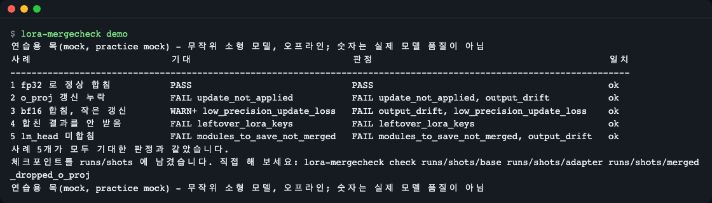
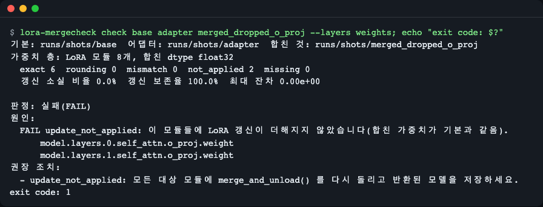
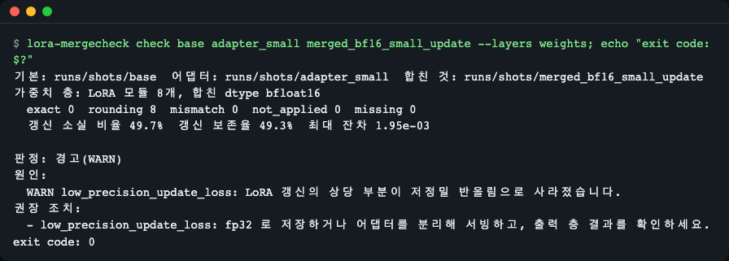
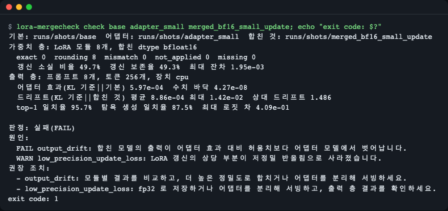
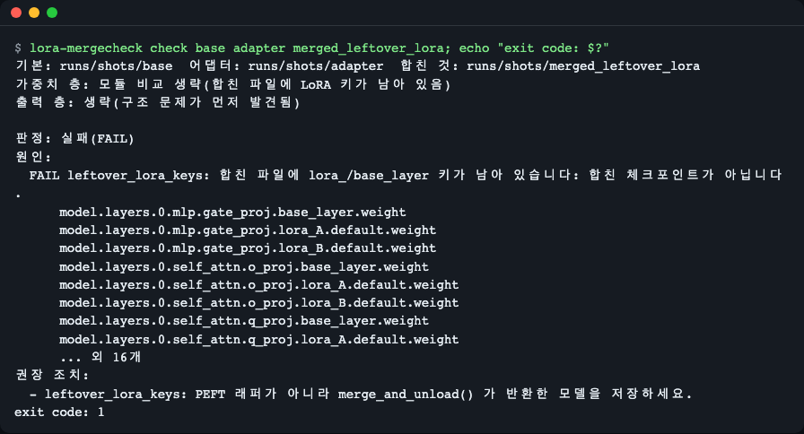
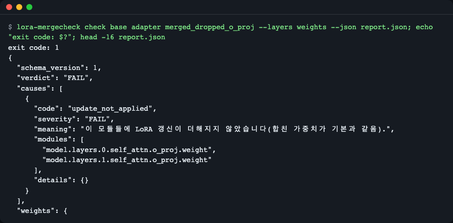
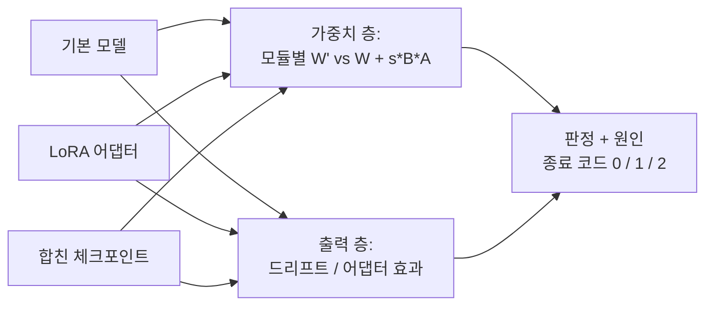

# lora-mergecheck

[English](README.md) | **한국어**

합친 LoRA 체크포인트가 정말 "기본 모델 + 어댑터"와 같은지 명령 하나로, 수치로 확인합니다. 모든 LoRA 모듈의 가중치를 대조하고(`W' = W + s·B·A`, dtype 별 반올림 상한 적용), 이어서 어댑터가 모델을 원래 얼마나 바꾸는지에 비춰 출력을 비교합니다. 종료 코드(0 통과, 1 실패, 2 입력 오류)로 CI 에서 잘못된 합치기를 막을 수 있습니다.


*`lora-mergecheck demo`: 무작위 소형 모델로 만든 합친 체크포인트 5개와 각각 도구가 내려야 할 판정(연습용 목, [빠르게 시작하기](#빠르게-시작하기) 참고).*

## 무엇을 확인하나

LoRA·QLoRA 파인튜닝 뒤에는 `merge_and_unload()` 를 호출해 배포용 체크포인트 하나로 저장합니다. 이때 조용히 틀어질 수 있는 일이 여럿 있습니다. 합친 결과가 아니라 PEFT 래퍼를 저장했거나, 모듈 하나를 건너뛰었거나, `lm_head` 같은 `modules_to_save` 층을 합치지 않았거나, bf16 으로 합치다 반올림이 작은 갱신 일부를 지워 버린 경우입니다. 로짓을 손으로 비교해서는 이 중 무엇이 일어났는지 알 수 없습니다.

어댑터를 기본 그림 위에 얹은 투명 필름이라고 생각해 보세요. 합친 체크포인트는 필름 내용을 그림에 옮겨 그린 복사본입니다. `lora-mergecheck` 는 복사본을 두 번 대조합니다. 가까이서(모듈별 가중치, dtype 에서 정상인 반올림 크기를 아는 돋보기로), 그리고 멀리서(모델 출력, 필름이 그림을 애초에 얼마나 바꾸는지와 비교) 봅니다.

- **가중치 층**은 `safetensors` 로 텐서를 하나씩만 읽고 모델을 불러오지 않습니다. 모듈마다 `exact`, `rounding`(dtype 의 2 ulp 이내), `mismatch`, `not_applied`, `missing` 으로 분류합니다. 또 *갱신 소실 비율*, 즉 저정밀 반올림으로 사라진 갱신 원소의 비율도 보고합니다. 남은 `lora_`/`base_layer` 키, 합쳐지지 않은 `modules_to_save` 층, 모양·어휘 크기 불일치, 양자화 체크포인트도 감지합니다.
- **출력 층**은 같은 프롬프트로 기준(기본 + 어댑터), 기본 단독, 합친 체크포인트를 불러옵니다. *상대 드리프트* = (기준→합친 것 KL) / (기준→기본 단독 KL) 을 보고합니다. 강한 어댑터에서 1% 어긋난 합치기는 통과하지만, 같은 절대 오차가 약한 어댑터에서는 통과하지 못합니다.

## 이런 분께

- 서빙·GGUF 변환·업로드 전에 LoRA/QLoRA 어댑터를 기본 모델에 합치는 분
- 합친 파일이 평가한 모델과 다르면 실패하는 CI 단계가 필요한 분
- bf16·fp16 으로 합쳤고 작은 갱신이 얼마나 남았는지 알고 싶은 분

## 설치

```bash
curl -LsSf https://astral.sh/uv/install.sh | sh   # uv 설치 (Python 3.11 이상은 자동으로 받습니다)
uv tool install git+https://github.com/LeeGyeongPil/lora-mergecheck
```

전역 설치 없이 clone 해서 쓸 수도 있습니다.

```bash
git clone https://github.com/LeeGyeongPil/lora-mergecheck && cd lora-mergecheck
uv sync
uv run lora-mergecheck --version
```

clone 으로 쓸 때는 이 문서의 모든 `lora-mergecheck` 명령 앞에 `uv run` 을 붙이세요(예: `uv run lora-mergecheck demo`).

```text
lora-mergecheck 0.1.0
```

처음 설치할 때 PyTorch 를 받으므로 용량이 큽니다(플랫폼에 따라 수백 MB~수 GB). 최소 리눅스 이미지에서는 `curl` 과 `git` 외에 추가 시스템 패키지가 필요 없습니다.

## 빠르게 시작하기

```bash
lora-mergecheck demo
```

`demo` 는 임시 폴더에 무작위 소형 Llama 모델과 합친 체크포인트 5개를 만들고, 각각을 검사해 표로 보여 줍니다. **연습용 목(mock) 모드**입니다. 아무것도 내려받지 않고 CPU 에서 오프라인으로 몇 초 안에 끝나며, 숫자는 실제 모델 품질을 뜻하지 않습니다. 실제 검사(아래)는 내 체크포인트를 쓰고, 출력 층이 모델 3개를 불러오므로 더 오래 걸릴 수 있습니다.

```text
연습용 목(mock, practice mock) - 무작위 소형 모델, 오프라인; 숫자는 실제 모델 품질이 아님
사례                          기대                              판정                                            일치
--------------------------------------------------------------------------------------------------------------------
1 fp32 로 정상 합침           PASS                              PASS                                            ok
2 o_proj 갱신 누락            FAIL update_not_applied           FAIL update_not_applied, output_drift           ok
3 bf16 합침, 작은 갱신        WARN+ low_precision_update_loss   FAIL output_drift, low_precision_update_loss    ok
4 합친 결과를 안 받음         FAIL leftover_lora_keys           FAIL leftover_lora_keys                         ok
5 lm_head 미합침              FAIL modules_to_save_not_merged   FAIL modules_to_save_not_merged, output_drift   ok
사례 5개가 모두 기대한 판정과 같았습니다.
연습용 목(mock, practice mock) - 무작위 소형 모델, 오프라인; 숫자는 실제 모델 품질이 아님
```

각 행이 합치기가 잘못되는 한 가지 방식입니다. `expected` 는 도구가 찾아야 할 것, `verdict` 는 실제로 찾은 것입니다. 사례 3 이 `WARN` 이 아니라 `FAIL` 인 것은 출력 층도 드리프트를 보기 때문입니다(아래 설명).

이 README 의 명령을 직접 따라 하려면 체크포인트를 남기세요.

```bash
lora-mergecheck demo --out demo-out
```

## 사용법

```bash
lora-mergecheck check BASE ADAPTER MERGED
```

| 인자 | 뜻 |
|---|---|
| `BASE` | 합치기 전 기본 모델 폴더(또는 `.safetensors` 파일 하나, 분할 폴더도 됩니다). |
| `ADAPTER` | PEFT LoRA 폴더(`adapter_config.json` + `adapter_model.safetensors`). |
| `MERGED` | 합친 체크포인트 폴더(또는 `.safetensors` 파일 하나). |

| 옵션 | 하는 일 |
|---|---|
| `--layers weights\|outputs\|all` | `weights` 는 모델을 불러오지 않습니다(텐서만, 빠름). 기본 `all`. |
| `--prompts FILE` | 출력 층에 쓸 프롬프트(한 줄에 하나, 기본 폴더에 토크나이저 필요). 기본: 무작위 토큰. |
| `--num-prompts N`, `--prompt-len N` | 무작위 프롬프트 수(8)와 길이(32). |
| `--gen-tokens N` | 탐욕 생성 비교에 쓸 토큰 수(16), `0` 이면 생략. |
| `--max-relative-drift X` | 어댑터 효과 대비 허용하는 출력 드리프트 상한(0.10). |
| `--warn-lost-ratio X` | 갱신 원소가 반올림으로 사라진 비율이 이 값 이상이면 경고(0.25). |
| `--device D` | 출력 층을 돌릴 장치(`cpu`). |
| `--json PATH` | 전체 보고서를 JSON 으로 저장(입력 폴더 안이면 안 됨). |
| `--strict` | `WARN`·`INCONCLUSIVE` 도 종료 코드 1 로 처리. |
| `--lang en\|ko` | 화면 언어. |

### 시나리오 1: 갱신이 빠졌다

합쳤는데 저장한 파일에 `o_proj` 갱신이 없습니다. 가중치만 검사합니다.

```bash
lora-mergecheck check demo-out/base demo-out/adapter demo-out/merged_dropped_o_proj --layers weights
```

```text
기본: demo-out/base  어댑터: demo-out/adapter  합친 것: demo-out/merged_dropped_o_proj
가중치 층: LoRA 모듈 8개, 합친 dtype float32
  exact 6  rounding 0  mismatch 0  not_applied 2  missing 0
  갱신 소실 비율 0.0%  갱신 보존율 100.0%  최대 잔차 0.00e+00

판정: 실패(FAIL)
원인:
  FAIL update_not_applied: 이 모듈들에 LoRA 갱신이 더해지지 않았습니다(합친 가중치가 기본과 같음).
      model.layers.0.self_attn.o_proj.weight
      model.layers.1.self_attn.o_proj.weight
권장 조치:
  - update_not_applied: 모든 대상 모듈에 merge_and_unload() 를 다시 돌리고 반환된 모델을 저장하세요.
```


*모듈 6개는 `exact`, 2개는 `not_applied` 이고 두 모듈 이름이 나옵니다. 종료 코드 1.*

읽는 법: LoRA 모듈 8개를 비교했고, 6개는 `base + s·B·A` 와 정확히 같고, 2개는 기본과 같아서 갱신이 닿지 않았습니다.

### 시나리오 2: bf16 반올림이 작은 갱신 일부를 지웠다

```bash
lora-mergecheck check demo-out/base demo-out/adapter_small demo-out/merged_bf16_small_update --layers weights
```

```text
기본: demo-out/base  어댑터: demo-out/adapter_small  합친 것: demo-out/merged_bf16_small_update
가중치 층: LoRA 모듈 8개, 합친 dtype bfloat16
  exact 0  rounding 8  mismatch 0  not_applied 0  missing 0
  갱신 소실 비율 49.7%  갱신 보존율 49.3%  최대 잔차 1.95e-03

판정: 경고(WARN)
원인:
  WARN low_precision_update_loss: LoRA 갱신의 상당 부분이 저정밀 반올림으로 사라졌습니다.
권장 조치:
  - low_precision_update_loss: fp32 로 저장하거나 어댑터를 분리해 서빙하고, 출력 층 결과를 확인하세요.
```


*`mismatch` 인 모듈은 없지만(8개 모두 bf16 반올림 범위 안), 갱신 원소의 절반 가까이가 사라졌습니다.*

정상 반올림은 오류로 보고하지 않지만, 거의 지워진 갱신은 표시합니다. `--strict` 를 주면 이 `WARN` 이 종료 코드 1 이 됩니다.

### 시나리오 3: 출력이 실제로 바뀌나

두 층을 모두 돌립니다(기본값).

```bash
lora-mergecheck check demo-out/base demo-out/adapter_small demo-out/merged_bf16_small_update
```

```text
기본: demo-out/base  어댑터: demo-out/adapter_small  합친 것: demo-out/merged_bf16_small_update
가중치 층: LoRA 모듈 8개, 합친 dtype bfloat16
  exact 0  rounding 8  mismatch 0  not_applied 0  missing 0
  갱신 소실 비율 49.7%  갱신 보존율 49.3%  최대 잔차 1.95e-03
출력 층: 프롬프트 8개, 토큰 256개, 장치 cpu
  어댑터 효과(KL 기준||기본) 5.97e-04  수치 바닥 4.27e-08
  드리프트(KL 기준||합친 것) 평균 8.86e-04 최대 1.42e-02  상대 드리프트 1.486
  top-1 일치율 95.7%  탐욕 생성 일치율 87.5%  최대 로짓 차 4.09e-01

판정: 실패(FAIL)
원인:
  FAIL output_drift: 합친 모델의 출력이 어댑터 효과 대비 허용치보다 어댑터 모델에서 벗어납니다.
  WARN low_precision_update_loss: LoRA 갱신의 상당 부분이 저정밀 반올림으로 사라졌습니다.
권장 조치:
  - output_drift: 모듈별 결과를 비교하고, 더 높은 정밀도로 합치거나 어댑터를 분리해 서빙하세요.
  - low_precision_update_loss: fp32 로 저장하거나 어댑터를 분리해 서빙하고, 출력 층 결과를 확인하세요.
```


*어댑터가 출력을 KL 5.97e-04 만큼 바꾸는데 합치기가 8.86e-04 만큼 움직였습니다. 상대 드리프트 1.486 으로 상한 0.10 을 넘습니다.*

어댑터 효과는 어댑터가 기본 모델 출력을 얼마나 움직이는지, 드리프트는 합친 모델이 어댑터 모델에서 얼마나 떨어졌는지입니다. 드리프트가 효과보다 크면 합친 모델은 어댑터 모델이 아닙니다. 효과 자체가 수치 잡음(`수치 바닥`) 수준이면 판정은 `INCONCLUSIVE` 이고, 도구가 `--prompts` 로 실제 프롬프트를 쓰라고 안내합니다.

### 시나리오 4: 합친 결과를 저장하지 않았다

```bash
lora-mergecheck check demo-out/base demo-out/adapter demo-out/merged_leftover_lora
```


*저장된 파일에 `lora_A`, `lora_B`, `base_layer` 키가 그대로 있습니다. 합친 모델이 아니라 PEFT 래퍼입니다. 출력 층은 건너뜁니다.*

## 원인과 해결

| 코드 | 심각도 | 뜻 | 해결 |
|---|---|---|---|
| `update_not_applied` | FAIL | 이 모듈들의 합친 가중치가 기본과 같음. | 모든 대상 모듈에 `merge_and_unload()` 를 다시 돌리고 반환된 모델을 저장. |
| `update_mismatch` | FAIL | `base + s·B·A` 와 반올림 범위를 넘어 다름. | 기본·어댑터·합친 것이 서로 맞는지(같은 기본, 같은 `lora_alpha`/`r`) 확인. |
| `leftover_lora_keys` | FAIL | 파일에 `lora_`/`base_layer` 키가 남음. | PEFT 래퍼가 아니라 `merge_and_unload()` 가 반환한 모델을 저장. |
| `non_lora_changed` | FAIL | 어댑터가 없는 층이 달라짐. | 같은 기본 가중치에서 합쳤는지 확인. |
| `modules_to_save_not_merged` | FAIL | 통째로 저장한 층(예: `lm_head`)에 어댑터 값이 없음. | 어댑터의 `modules_to_save` 까지 포함해 합친 뒤 저장. |
| `vocab_resized_without_saved_embeddings` | FAIL | 어휘가 늘었는데 임베딩을 저장하지 않음. | 기본 임베딩을 먼저 늘리고 `embed_tokens`/`lm_head` 를 `modules_to_save` 로 저장. |
| `shape_mismatch`, `missing_tensor` | FAIL | 모양이 다르거나 텐서가 없음. | 이 기본에서 만들고 모든 샤드를 저장. |
| `output_drift` | FAIL | 어댑터 효과 대비 출력 드리프트가 상한 초과. | 모듈별 결과를 비교하고 더 높은 정밀도로 합치거나 어댑터를 분리해 서빙. |
| `quantized_checkpoint` | WARN | 양자화 체크포인트라 가중치 비교 생략. | 양자화하지 않은 기본에 먼저 합친 뒤 양자화. |
| `low_precision_update_loss` | WARN | 갱신 상당 부분이 반올림으로 사라짐. | fp32 로 저장하거나 어댑터를 분리해 서빙. |
| `unsupported_layer` | WARN | 지원하지 않는 종류의 어댑터 층을 판정에서 뺌. | 그 층은 다른 방법으로 확인. |
| `outputs_unavailable` | WARN | 출력 층을 실행하지 못함. | `--layers weights` 를 쓰거나 폴더가 `transformers` 로 불러와지는지 확인. |
| `adapter_effect_too_small` | INCONCLUSIVE | 이 프롬프트에서 어댑터 효과가 잡음 수준. | 어댑터가 답을 바꾸는 실제 프롬프트(`--prompts FILE`)로 다시 실행. |

## CI 에서 쓰기

| 종료 코드 | 뜻 |
|---|---|
| 0 | `PASS`, 또는 `--strict` 없이 `WARN`/`INCONCLUSIVE` |
| 1 | `FAIL`, 또는 `--strict` 와 함께 `WARN`/`INCONCLUSIVE` |
| 2 | 입력 오류(없는 경로, DoRA 같은 미지원 어댑터, 잘못된 옵션) |

```bash
lora-mergecheck check base adapter merged --json report.json --strict
```

JSON 보고서 필드: `schema_version`, `verdict`, `causes[{code, severity, meaning, modules, details}]`, `weights`, `outputs`, `recommendations[{code, text}]`, `inputs`, `versions`.


*실패한 검사는 종료 코드 1 을 돌려주고, JSON 파일에는 판정과 원인 목록이 남아 다음 단계에서 쓸 수 있습니다.*

GitHub Actions 단계는 `uv tool install git+https://github.com/LeeGyeongPil/lora-mergecheck` 다음에 위 명령을 쓰면 됩니다. Python API:

```python
from lora_mergecheck import check_merge

report = check_merge("demo-out/base", "demo-out/adapter", "demo-out/merged_dropped_o_proj", layers="weights")
print(report.verdict)
print([c.code for c in report.causes])
```

```text
FAIL
['update_not_applied']
```

## 설정

| 변수 | 용도 |
|---|---|
| `LORA_MERGECHECK_LANG` | `en` 또는 `ko`. 우선순위: `--lang`, 이 변수, `LC_ALL`/`LC_MESSAGES`/`LANG`. 한국어가 아니면 영어. |
| `HF_HUB_OFFLINE` | `1` 이면 Hub 접속 금지. 도구는 어느 쪽이든 로컬 폴더만(`local_files_only`) 불러오며, 테스트와 데모는 이 값을 켜고 실행합니다. |

API 키는 필요 없습니다. 한국어 모드(`--lang ko`)에서도 판정 단어는 `실패(FAIL)` 처럼 영어 표기를 괄호에 남기고, 원인 코드와 모듈 이름은 영어 그대로여서 스크립트가 계속 매칭할 수 있으며, 설명 문장만 번역됩니다.
## 동작 원리



- **가중치 층**: LoRA 모듈마다 기대하는 합친 가중치는 (합친 dtype 으로 캐스팅한 기본) + fp32 로 계산한 `s·B·A` 입니다. 잔차를 dtype 의 반올림 단위(ulp)와 비교합니다. 아주 작은 잔차는 `rounding`, 기본과 그대로인 모듈은 `not_applied` 입니다.
- **출력 층**: 같은 프롬프트로 모델 세 개를 돌립니다. 기준(fp32 의 기본 + 어댑터), 어댑터를 끈 기본, 합친 체크포인트입니다. 드리프트를 어댑터 효과로 나누므로 한계는 내 어댑터가 얼마나 중요한지에 따라 달라집니다. 수치 바닥(같은 합치기를 fp32 메모리에서 한 결과)으로 효과가 측정 가능한 크기인지 알려 줍니다.
- **판정**: `PASS`, `WARN`, `FAIL`, `INCONCLUSIVE` 중 하나이며, 모든 원인에 코드와 권장 조치가 붙습니다.

## 언제 쓰나

- 잘 맞는 경우: Linear 층의 일반 LoRA/QLoRA 어댑터를 Hugging Face 형식 체크포인트로 합친 뒤, 서빙이나 변환 전에 확인할 때.
- 다른 방법으로 확인할 경우: DoRA 어댑터는 거부합니다(종료 코드 2). Conv/임베딩 LoRA 와 trainable tokens 는 `unsupported_layer` 로 보고합니다. 실제 bitsandbytes 4비트 텐서는 양자화 여부만 감지하고 풀어서 비교하지 않습니다.
- 함께 쓸 만한 도구: [PEFT](https://github.com/huggingface/peft) 는 합치기 자체를, [lm-evaluation-harness](https://github.com/EleutherAI/lm-evaluation-harness) 는 작업 품질 측정을 맡습니다. 이 도구는 합치기가 어댑터 모델을 보존했는지만 확인하며, 어댑터가 좋은지는 판단하지 않습니다.

## 한계

- 출력 층은 합친 체크포인트를 fp32 로 올려 불러오므로 bf16 추론 연산이 아니라 저장된 값을 측정합니다. 기본을 bf16 으로 캐스팅하는 것 자체가 약한 어댑터에서는 드리프트로 나타납니다. 기본 한계값(0.10, 0.25, 바닥의 10배)은 무작위 소형 모델에서 맞춘 출발점입니다.
- 출력 층 메모리 어림값: 한 번에 fp32 모델 하나만 메모리에 둡니다. 파라미터 수 x 약 4 bytes(1B 모델은 약 4 GB, 7B 는 약 28 GB)에 로짓(프롬프트 수 x 길이 x vocab x 4 bytes, 기본 8 x 32 토큰·vocab 32k 기준 약 33 MB)이 더해집니다. 큰 모델은 모델을 불러오지 않는 `--layers weights` 를 쓰세요.

## 자주 겪는 문제

| 증상 | 원인 | 해결 |
|---|---|---|
| `error: path not found: ...` 와 종료 코드 2 | 폴더나 파일이 없음. | 존재하는 폴더나 `.safetensors` 파일을 넘기세요. |
| 어댑터에서 종료 코드 2 | DoRA 어댑터는 지원하지 않음. | 그 어댑터는 다른 방법으로 확인하세요. |
| `INCONCLUSIVE adapter_effect_too_small` | 무작위 프롬프트가 어댑터를 거의 느끼지 못함. | 실제 문장으로 `--prompts FILE` 을 쓰세요. 기본 폴더에 토크나이저가 필요합니다. |
| 출력 층이 느리거나 메모리 부족 | 모델 3개를 한 번에 하나씩 불러옴(한계 절의 메모리 어림값 참고). | `--layers weights` 를 쓰거나 GPU 가 있으면 `--device cuda`. |
| `error: ... 를 safetensors 로 읽을 수 없습니다: ...` 와 종료 코드 2 | 파일이 잘렸거나 safetensors 가 아님(예: 디스크가 가득 찬 상태에서 저장). | `safe_serialization=True` 로 체크포인트를 다시 저장하세요. |
| `--json` 거부 | 경로가 입력 폴더 안. | 보고서를 다른 곳에 저장하세요. |
| 영어가 아니라 한국어가 나옴 | 로케일이 한국어. | `--lang en` 을 주거나 `LORA_MERGECHECK_LANG=en`. |

## 개발·기여

```bash
uv sync
uv run pytest -q
```

테스트 65개, CPU 전용·오프라인. 버그·제안은 이슈로 남겨 주세요. 변경 기록은 [CHANGELOG.md](CHANGELOG.md).

## 출처

2026-11-14 확인.
- PEFT LoRA 가이드(`merge_and_unload`): https://huggingface.co/docs/peft/main/en/developer_guides/lora
- PEFT 저장소: https://github.com/huggingface/peft
- 합친 모델의 출력이 달라진다는 포럼 글: https://discuss.huggingface.co/t/model-merging-leads-to-different-output/103986

## 라이선스

MIT. 데모는 무작위로 초기화한 모델을 쓰며 사전학습 가중치나 데이터셋은 쓰지 않습니다.
