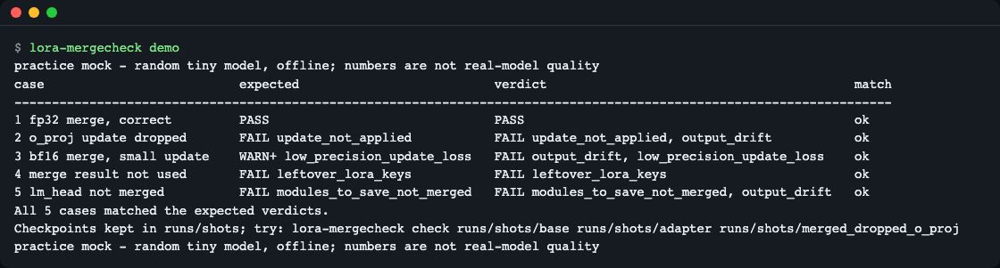
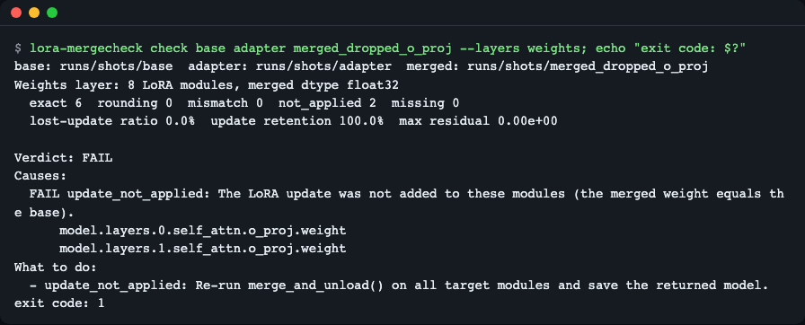
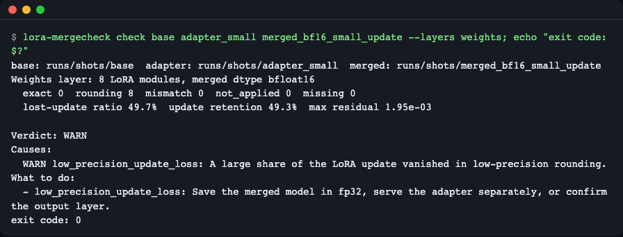
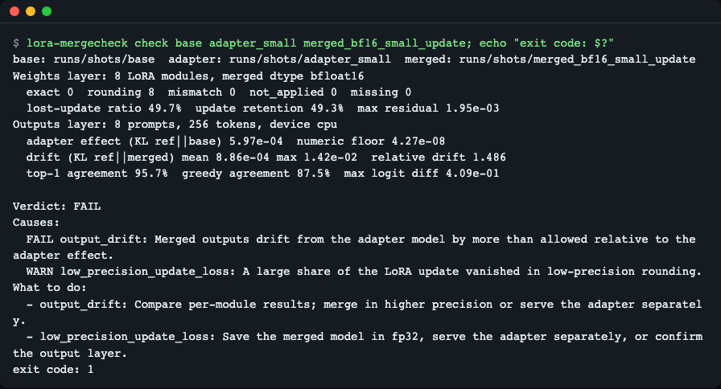
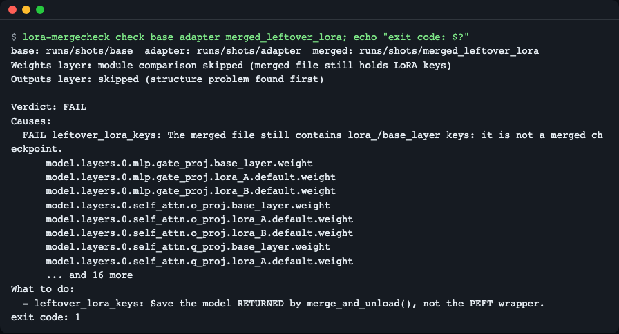
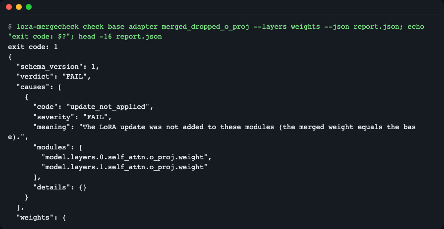
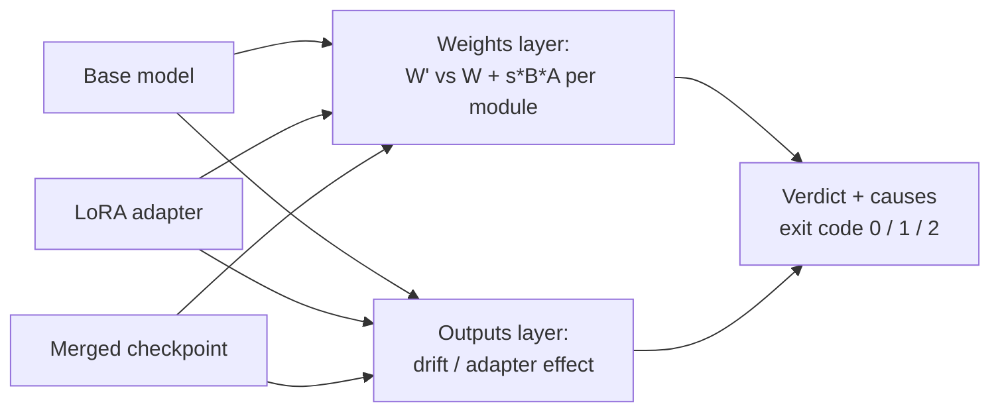

# lora-mergecheck

**English** | [한국어](README.ko.md)

Check that a merged LoRA checkpoint really equals "base model + adapter", from one command and with numbers. It compares every LoRA module's weights (`W' = W + s·B·A`, with a dtype-aware rounding limit) and then compares model outputs, scaled by how much the adapter changes the model in the first place. The exit code (0 pass, 1 fail, 2 input error) lets CI block a bad merge.


*`lora-mergecheck demo`: five merged checkpoints built on a random tiny model, each with the verdict the tool should reach (practice mock, see [Quick start](#quick-start)).*

## What it checks

After LoRA or QLoRA fine-tuning you call `merge_and_unload()` and save one checkpoint for deployment. Several things can silently go wrong: the merge result was never saved (the PEFT wrapper was), one module was skipped, a `modules_to_save` layer such as `lm_head` was not merged, or the merge ran in bf16 and rounding erased part of a small update. Comparing logits by hand does not tell you which of these happened.

Think of the adapter as a transparent film laid over the base picture. The merged checkpoint is a copy where the film was painted onto the picture. `lora-mergecheck` checks the copy twice: up close (each module's weights, with a magnifier that knows how much rounding is normal for the dtype) and from a distance (the model's outputs, compared with how much the film changes the picture at all).

- **Weights layer** reads tensors one at a time with `safetensors`, no model load. Per module it labels the result `exact`, `rounding` (within 2 ulp of the dtype), `mismatch`, `not_applied` or `missing`. It also reports the *lost-update ratio*: the share of update elements that vanished in low-precision rounding. It also detects leftover `lora_`/`base_layer` keys, unmerged `modules_to_save` layers, shape or vocabulary mismatches, and quantized checkpoints.
- **Outputs layer** loads the reference (base + adapter), the base alone and the merged checkpoint on the same prompts. It reports *relative drift* = (KL from reference to merged) / (KL from reference to base alone). A merge that is 1% off a strong adapter passes; the same absolute error on a weak adapter does not.

## Who it is for

- You merge a LoRA/QLoRA adapter into a base model before serving, converting to GGUF or uploading.
- You want a CI step that fails when the merged file is not the model you evaluated.
- You merged in bf16 or fp16 and want to know how much of a small update survived.

## Install

```bash
curl -LsSf https://astral.sh/uv/install.sh | sh   # installs uv (Python 3.11+ is fetched automatically)
uv tool install git+https://github.com/LeeGyeongPil/lora-mergecheck
```

Or from a clone, without installing globally:

```bash
git clone https://github.com/LeeGyeongPil/lora-mergecheck && cd lora-mergecheck
uv sync
uv run lora-mergecheck --version
```

From a clone, put `uv run` in front of every `lora-mergecheck` command in this README (for example `uv run lora-mergecheck demo`).

```text
lora-mergecheck 0.1.1
```

The first install downloads PyTorch, which is large (several hundred MB to a few GB depending on the platform). No extra system packages are needed on a minimal Linux image beyond `curl` and `git`.

## Quick start

```bash
lora-mergecheck demo
```

`demo` builds a random tiny Llama model and five merged checkpoints in a temporary folder, checks each one and prints a table. It is a **practice mock**: nothing is downloaded, everything runs offline on the CPU in a few seconds, and the numbers say nothing about real-model quality. A real check (below) uses your own checkpoints and can take longer because the output layer loads three models.

```text
practice mock - random tiny model, offline; numbers are not real-model quality
case                          expected                          verdict                                         match
---------------------------------------------------------------------------------------------------------------------
1 fp32 merge, correct         PASS                              PASS                                            ok
2 o_proj update dropped       FAIL update_not_applied           FAIL update_not_applied, output_drift           ok
3 bf16 merge, small update    WARN+ low_precision_update_loss   FAIL output_drift, low_precision_update_loss    ok
4 merge result not used       FAIL leftover_lora_keys           FAIL leftover_lora_keys                         ok
5 lm_head not merged          FAIL modules_to_save_not_merged   FAIL modules_to_save_not_merged, output_drift   ok
All 5 cases matched the expected verdicts.
practice mock - random tiny model, offline; numbers are not real-model quality
```

Each row is one way a merge goes wrong. `expected` is what the tool should find, `verdict` is what it found. Case 3 is judged `FAIL` instead of just `WARN` because the output layer also sees the drift (explained below).

Keep the checkpoints to try the commands in this README yourself:

```bash
lora-mergecheck demo --out demo-out
```

## Usage

```bash
lora-mergecheck check BASE ADAPTER MERGED
```

| Argument | Meaning |
|---|---|
| `BASE` | Base model folder before merging (or one `.safetensors` file; sharded folders work). |
| `ADAPTER` | PEFT LoRA folder (`adapter_config.json` + `adapter_model.safetensors`). |
| `MERGED` | Merged checkpoint folder (or one `.safetensors` file). |

| Option | What it does |
|---|---|
| `--layers weights\|outputs\|all` | `weights` never loads a model (fast, tensors only). Default `all`. |
| `--prompts FILE` | One prompt per line for the output layer (needs a tokenizer in the base folder). Default: random token ids. |
| `--num-prompts N`, `--prompt-len N` | Random prompt count (8) and length (32). |
| `--gen-tokens N` | Tokens for the greedy-generation comparison (16), `0` skips it. |
| `--max-relative-drift X` | Largest allowed output drift relative to the adapter effect (0.10). |
| `--warn-lost-ratio X` | Warn when this share of update elements vanished in rounding (0.25). |
| `--device D` | Device for the output layer (`cpu`). |
| `--json PATH` | Write the full report as JSON (must not be inside an input folder). |
| `--strict` | Treat `WARN` and `INCONCLUSIVE` as exit code 1 too. |
| `--lang en\|ko` | Display language. |

### Scenario 1: an update was dropped

You merged, but the `o_proj` update is missing from the saved file. Weights-only check:

```bash
lora-mergecheck check demo-out/base demo-out/adapter demo-out/merged_dropped_o_proj --layers weights
```

```text
base: demo-out/base  adapter: demo-out/adapter  merged: demo-out/merged_dropped_o_proj
Weights layer: 8 LoRA modules, merged dtype float32
  exact 6  rounding 0  mismatch 0  not_applied 2  missing 0
  lost-update ratio 0.0%  update retention 100.0%  max residual 0.00e+00

Verdict: FAIL
Causes:
  FAIL update_not_applied: The LoRA update was not added to these modules (the merged weight equals the base).
      model.layers.0.self_attn.o_proj.weight
      model.layers.1.self_attn.o_proj.weight
What to do:
  - update_not_applied: Re-run merge_and_unload() on all target modules and save the returned model.
```


*Six modules are `exact`, two are `not_applied`, and the two module names are listed. Exit code 1.*

Read it as: 8 LoRA modules were compared; 6 match `base + s·B·A` exactly; 2 equal the base, so the update never reached them.

### Scenario 2: bf16 rounding ate part of a small update

```bash
lora-mergecheck check demo-out/base demo-out/adapter_small demo-out/merged_bf16_small_update --layers weights
```

```text
base: demo-out/base  adapter: demo-out/adapter_small  merged: demo-out/merged_bf16_small_update
Weights layer: 8 LoRA modules, merged dtype bfloat16
  exact 0  rounding 8  mismatch 0  not_applied 0  missing 0
  lost-update ratio 49.7%  update retention 49.3%  max residual 1.95e-03

Verdict: WARN
Causes:
  WARN low_precision_update_loss: A large share of the LoRA update vanished in low-precision rounding.
What to do:
  - low_precision_update_loss: Save the merged model in fp32, serve the adapter separately, or confirm the output layer.
```


*No module is a `mismatch` (all 8 are within bf16 rounding), yet about half of the update elements vanished.*

Normal rounding is not reported as an error, but a nearly erased update is flagged. `--strict` turns this `WARN` into exit code 1.

### Scenario 3: does the output actually change?

Run both layers (the default):

```bash
lora-mergecheck check demo-out/base demo-out/adapter_small demo-out/merged_bf16_small_update
```

```text
base: demo-out/base  adapter: demo-out/adapter_small  merged: demo-out/merged_bf16_small_update
Weights layer: 8 LoRA modules, merged dtype bfloat16
  exact 0  rounding 8  mismatch 0  not_applied 0  missing 0
  lost-update ratio 49.7%  update retention 49.3%  max residual 1.95e-03
Outputs layer: 8 prompts, 256 tokens, device cpu
  adapter effect (KL ref||base) 5.97e-04  numeric floor 4.27e-08
  drift (KL ref||merged) mean 8.86e-04 max 1.42e-02  relative drift 1.486
  top-1 agreement 95.7%  greedy agreement 87.5%  max logit diff 4.09e-01

Verdict: FAIL
Causes:
  FAIL output_drift: Merged outputs drift from the adapter model by more than allowed relative to the adapter effect.
  WARN low_precision_update_loss: A large share of the LoRA update vanished in low-precision rounding.
What to do:
  - output_drift: Compare per-module results; merge in higher precision or serve the adapter separately.
  - low_precision_update_loss: Save the merged model in fp32, serve the adapter separately, or confirm the output layer.
```


*The adapter changes the output by KL 5.97e-04, but the merge moved it by 8.86e-04: relative drift 1.486, above the 0.10 limit.*

The adapter effect is how far the adapter moves the base model's output. Drift is how far the merged model is from the adapter model. Drift larger than the effect means the merged model is not the adapter model. If the effect itself is at numeric-noise level (`numeric floor`), the verdict is `INCONCLUSIVE` and the tool asks for real prompts via `--prompts`.

### Scenario 4: the merge result was never saved

```bash
lora-mergecheck check demo-out/base demo-out/adapter demo-out/merged_leftover_lora
```


*The saved file still has `lora_A`, `lora_B` and `base_layer` keys: it is the PEFT wrapper, not the merged model. The output layer is skipped.*

## Causes and fixes

| Code | Severity | Meaning | Fix |
|---|---|---|---|
| `update_not_applied` | FAIL | Merged weight equals the base for these modules. | Re-run `merge_and_unload()` on all target modules and save the returned model. |
| `update_mismatch` | FAIL | Differs from `base + s·B·A` by more than rounding allows. | Confirm base, adapter and merged belong together (same base, same `lora_alpha`/`r`). |
| `leftover_adapter_config` | FAIL | Merged folder still contains `adapter_config.json`, so transformers loads it as an adapter and fails. | Delete `adapter_config.json` from the merged folder or move it elsewhere. |
| `leftover_lora_keys` | FAIL | File still contains `lora_`/`base_layer` keys. | Save the model returned by `merge_and_unload()`, not the PEFT wrapper. |
| `non_lora_changed` | FAIL | Layers without an adapter changed. | Check the merge started from the same base weights. |
| `modules_to_save_not_merged` | FAIL | Fully saved layers (e.g. `lm_head`) lack the adapter values. | Merge with the adapter's `modules_to_save` included, then save. |
| `vocab_resized_without_saved_embeddings` | FAIL | Vocabulary grew but embeddings were not saved. | Resize base embeddings first, save `embed_tokens`/`lm_head` via `modules_to_save`. |
| `shape_mismatch`, `missing_tensor` | FAIL | Shapes differ or tensors are missing. | Build from this base; save all shards. |
| `output_drift` | FAIL | Output drift above the limit relative to the adapter effect. | Compare per-module results; merge in higher precision or serve the adapter separately. |
| `quantized_checkpoint` | WARN | Quantized checkpoint, weight comparison skipped. | Merge into a non-quantized base first, then quantize. |
| `low_precision_update_loss` | WARN | Much of the update vanished in rounding. | Save in fp32 or serve the adapter separately. |
| `unsupported_layer` | WARN | Adapter layers of an unsupported type were left out. | Verify those layers another way. |
| `outputs_unavailable` | WARN | The output layer could not run. | Use `--layers weights`, or check the folders load with `transformers`. |
| `adapter_effect_too_small` | INCONCLUSIVE | Adapter effect is at noise level on these prompts. | Re-run with `--prompts FILE` where the adapter changes the answer. |

## Use in CI

| Exit code | Meaning |
|---|---|
| 0 | `PASS`, or `WARN`/`INCONCLUSIVE` without `--strict` |
| 1 | `FAIL`, or `WARN`/`INCONCLUSIVE` with `--strict` |
| 2 | Input error (missing path, unsupported adapter such as DoRA, bad option) |

```bash
lora-mergecheck check base adapter merged --json report.json --strict
```

The JSON report has `schema_version`, `verdict`, `causes[{code, severity, meaning, modules, details}]`, `weights`, `outputs`, `recommendations[{code, text}]`, `inputs` and `versions`.


*A failing check returns exit code 1; the JSON file keeps the verdict and the cause list for later steps.*

A GitHub Actions step is just `uv tool install git+https://github.com/LeeGyeongPil/lora-mergecheck` followed by the command above. Python API:

```python
from lora_mergecheck import check_merge

report = check_merge("demo-out/base", "demo-out/adapter", "demo-out/merged_dropped_o_proj", layers="weights")
print(report.verdict)
print([c.code for c in report.causes])
```

```text
FAIL
['update_not_applied']
```

## Settings

| Variable | Purpose |
|---|---|
| `LORA_MERGECHECK_LANG` | `en` or `ko`. Order: `--lang`, then this variable, then `LC_ALL`/`LC_MESSAGES`/`LANG`; anything but Korean gives English. |
| `HF_HUB_OFFLINE` | Set to `1` to forbid Hub access. The tool only loads local folders (`local_files_only`) either way; tests and the demo run with it on. |

No API key is needed. In Korean mode (`--lang ko`) the verdict words (shown as e.g. `실패(FAIL)`), the cause codes and the module names stay in English so scripts can still match them; the explanations are translated. The README screenshots for Korean are in [README.ko.md](README.ko.md).

## How it works



- **Weights layer**: for each LoRA module the expected merged weight is the base (cast to the merged dtype) plus `s·B·A` computed in fp32. The residual is compared to the dtype's rounding step (ulp). Tiny residuals are `rounding`; a module still equal to the base is `not_applied`.
- **Outputs layer**: three models run on the same prompts: reference (base + adapter in fp32), base with the adapter off, and the merged checkpoint. Drift is divided by the adapter effect, so the limit scales with how much your adapter matters. A numeric floor (the same merge done in fp32 memory) tells whether the effect is measurable at all.
- **Verdict**: `PASS`, `WARN`, `FAIL` or `INCONCLUSIVE`, every cause with a code and a recommended action.

## When to use it

- Good fit: plain LoRA/QLoRA adapters on Linear layers, merged into a Hugging Face style checkpoint, checked before serving or conversion.
- Verify by other means: DoRA adapters are rejected (exit 2). Conv/embedding LoRA and trainable tokens are reported as `unsupported_layer`. For real bitsandbytes 4-bit tensors the tool only detects the quantization and does not dequantize.
- Other tools you may combine with it: [PEFT](https://github.com/huggingface/peft) does the merge itself, [lm-evaluation-harness](https://github.com/EleutherAI/lm-evaluation-harness) measures task quality. This tool checks that the merge preserved the adapter model, not whether the adapter is good.

## Limits

- The outputs layer loads the merged checkpoint upcast to fp32, so it measures the stored values, not bf16 inference arithmetic. Casting the base to bf16 itself shows up as drift for weak adapters. The default limits (0.10, 0.25, 10x floor) were calibrated on a random tiny model and are starting points.
- Memory rule of thumb for the outputs layer: it keeps one fp32 model in memory at a time, about 4 bytes x parameters (about 4 GB for a 1B model, about 28 GB for 7B), plus the logits (prompts x length x vocab x 4 bytes, about 33 MB for the default 8 x 32 tokens and a 32k vocabulary). For large models use `--layers weights`, which loads no model.

## Troubleshooting

| Symptom | Cause | Fix |
|---|---|---|
| `error: path not found: ...` and exit 2 | A folder or file does not exist. | Pass existing folders or `.safetensors` files. |
| Exit 2 for an adapter | DoRA adapters are not supported. | Verify that adapter another way. |
| `INCONCLUSIVE adapter_effect_too_small` | Random prompts barely feel the adapter. | Use `--prompts FILE` with real text; the base folder needs a tokenizer. |
| Output layer is slow or out of memory | It loads three models, one at a time (see the memory rule of thumb under Limits). | Use `--layers weights`, or `--device cuda` if you have a GPU. |
| `error: cannot read ... as safetensors: ...` and exit 2 | The file is truncated or not safetensors (for example a disk-full save). | Save the checkpoint again with `safe_serialization=True`. |
| `--json` refused | The path is inside an input folder. | Write the report elsewhere. |
| Korean text appears unexpectedly | Your locale is Korean. | Pass `--lang en` or set `LORA_MERGECHECK_LANG=en`. |

## Development

```bash
uv sync
uv run pytest -q
```

69 tests, CPU only and offline. Bugs and ideas are welcome as issues. See [CHANGELOG.md](CHANGELOG.md).

## Sources

Checked on 2026-11-14.
- PEFT LoRA guide (`merge_and_unload`): https://huggingface.co/docs/peft/main/en/developer_guides/lora
- PEFT repository: https://github.com/huggingface/peft
- Forum thread on merged models giving different outputs: https://discuss.huggingface.co/t/model-merging-leads-to-different-output/103986

## License

MIT. The demo uses a randomly initialized model; no pretrained weights or datasets are involved.
